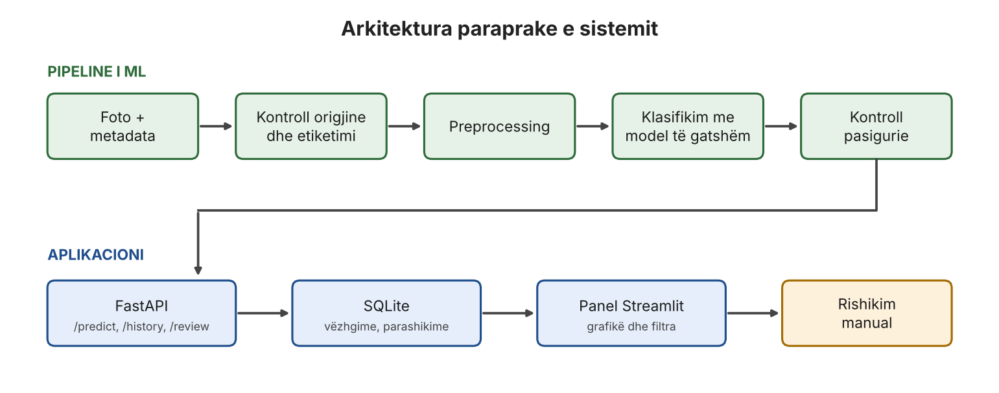

# Monitorimi i agrobiodiversitetit me AI (Projekti 03)

Projekt për lëndën **Data Mining**. Prototip pilot që klasifikon, nga një fotografi, grupin e një insekti dominues në një kulturë bujqësore (kultura e propozuar: domate), tregon një shkallë pasigurie dhe i ruan vëzhgimet në një aplikacion me panel dhe rishikim manual.

> **Statusi:** Java 1 (planifikim). Asnjë model nuk është trajnuar ende.

## Objektivi

Të përgjigjemi: *a mund të dallohen disa grupe insektesh në fotografi me një individ dominues, duke përdorur transfer learning mbi modele të parapërgatitura?*

Tri qasje krahasohen në të njëjtat kushte:

1. Baseline: veçori nga një rrjet pretrained + Logistic Regression
2. MobileNetV3-Small (transfer learning / fine-tuning)
3. EfficientNet-B0 (transfer learning / fine-tuning)

## Kufizimet

- Ekipi **nuk ka ekspert agronom/entomolog dhe nuk ka fermë partnere**. Etiketat bazohen në verifikimin komunitar të platformave publike (`community-verified`).
- Rezultatet janë **provë teknike e modelit**, jo provë përdorshmërie në parcela shqiptare.
- Jashtë fushës: këshilla pesticidi, vlerësim dëmi ekonomik, përmirësim rendimenti, numërim automatik, vendime "i dobishëm / dëmtues".
- Përdoren vetëm fotografi me licencë dhe autorizim të verifikuar.

## Klasat kandidate (provizore)

Coccinellidae, Syrphidae, bletë mjalti (*Apis mellifera*), larva Lepidoptera, afide. Lista përfundimtare vendoset në portën GO / NARROW / STOP (Java 4).

## Ekipi

| Roli | Emri |
|---|---|
| Koordinim / produkt | [Emri] |
| Të dhënat | [Emri] |
| Machine Learning | [Emri] |
| Backend / UI | [Emri] |

## Arkitektura



`foto + metadata -> kontroll origjine/etiketimi -> preprocessing -> klasifikim -> kontroll pasigurie -> FastAPI -> SQLite -> Streamlit -> rishikim manual`

## Struktura e repository-t

```
docs/         charter, regjistri i burimeve, skema, diagrami
data/         vetëm skedarë metadata (fotot NUK ngarkohen në Git)
notebooks/    eksperimente dhe tutoriale
src/          trajnim, inferencë, API, aplikacion
tests/        teste
```

## Si ta nisim

*(Do të plotësohet në Javën 2, kur të ketë kod.)*

```bash
python -m venv .venv
# Windows: .venv\Scripts\activate    macOS/Linux: source .venv/bin/activate
pip install -r requirements.txt
```

## Rregullat e punës me Git

- Mos punoni drejtpërdrejt në `main`. Çdo detyrë ka branch të vetin (p.sh. `data/source-register`, `ml/baseline`).
- Bashkimi në `main` bëhet me Pull Request, i rishikuar nga të paktën një anëtar tjetër.
- Mesazhet e commit-it janë të shkurtra dhe përshkruese.
- Fotografitë, checkpoint-et e modeleve dhe skedarët `.db` nuk futen në Git.

## Dokumente

- Project Charter: `docs/project_charter.md`
- Regjistri i burimeve dhe lejeve: `docs/source_register.md`
- Skema e të dhënave v0: `docs/schema_v0.sql`
